# KnowledgeSpace — Manual de usuario

Cómo usar KnowledgeSpace para convertir la documentación de una empresa en
asistentes que responden preguntas sobre ella. Es la segunda mitad del anexo
10.1 de la memoria; la primera, cómo desplegar la aplicación, está en
`knowledgespace-tfm-backend/docs/TFM/DEPLOYMENT.md`.

Aplicación de demostración: https://knowledgespace-tfm-frontend.vercel.app

---

## 1. Antes de empezar: cuentas y roles

**No hay registro público.** Las cuentas las crea un administrador desde
**Usuarios**. La primera cuenta de una instalación nueva, el superadministrador,
se crea al desplegar (ver la guía de despliegue, «Primer arranque»).

Cada cuenta pertenece a una empresa y solo ve los datos de esa empresa. Hay tres
roles:

| Sección | `user` | `admin` | `superadmin` |
|---|---|---|---|
| Documentos, Etiquetas, Categorías | ✅ | ✅ | ✅ |
| Asistentes y Chat IA | ✅ | ✅ | ✅ |
| Dashboard, Feedback IA, Notificaciones, Sin respuesta | ✅ | ✅ | ✅ |
| Usuarios | — | ✅ | ✅ |
| Empresas | — | ✅ | ✅ |

**Limitación conocida:** el rol solo restringe **Usuarios** y **Empresas** (y la
consulta de costos en la API). En el resto de secciones, un usuario normal
puede hacer lo mismo que un administrador de su empresa, incluido borrar
documentos o editar asistentes. No hay permisos por documento ni por acción.

---

## 2. La pantalla principal

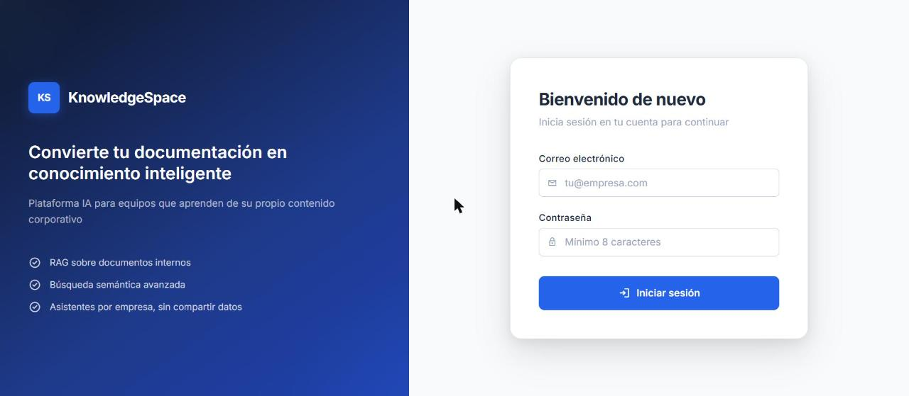

Al iniciar sesión se llega al **Dashboard**. El menú lateral agrupa las
secciones:

- **Conocimiento:** Documentos, Etiquetas, Categorías.
- **Plataforma:** Asistentes.
- **Administración** (solo administradores): Empresas, Usuarios.
- **Analytics:** Dashboard, Feedback IA, Notificaciones (con el número de avisos
  sin leer) y Sin respuesta.

En la cabecera, el botón **Chat IA** abre el chat en un panel lateral desde
cualquier sección, sin salir de la pantalla en la que se está. El botón ☰
pliega el menú lateral.

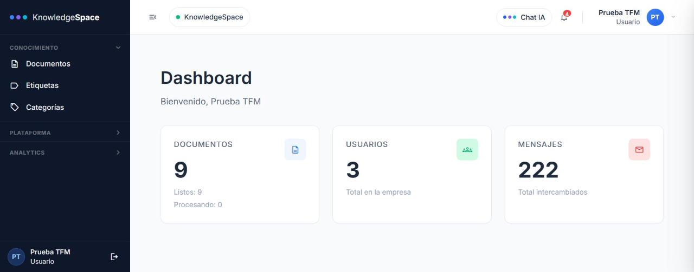

---

## 3. El flujo principal, en cuatro pasos

### Paso 1. Crear un asistente

Un asistente es un espacio de conocimiento: responde **solo** con los
documentos que se le asignan.

1. **Asistentes → Nuevo Asistente.**

   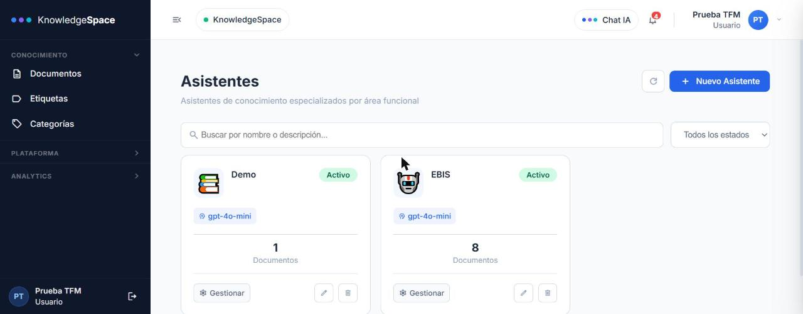
2. Completar el **nombre** (obligatorio), la descripción, el **prompt de
   sistema** (su personalidad: tono, rol y restricciones) y el **modelo**. Se
   puede añadir un avatar y hasta seis **preguntas sugeridas**, que aparecerán
   en el chat.
3. Guardar.

El prompt de sistema define **cómo habla** el asistente, pero no puede desactivar
las reglas que le impiden inventar: responder solo con los documentos y decir
«No encontré información…» cuando no los tiene se aplica siempre, se escriba lo
que se escriba en ese campo.

La **temperatura** aparece bloqueada en 0: no se puede cambiar, porque es el
valor que dio las respuestas más fieles a los documentos al medirlo.

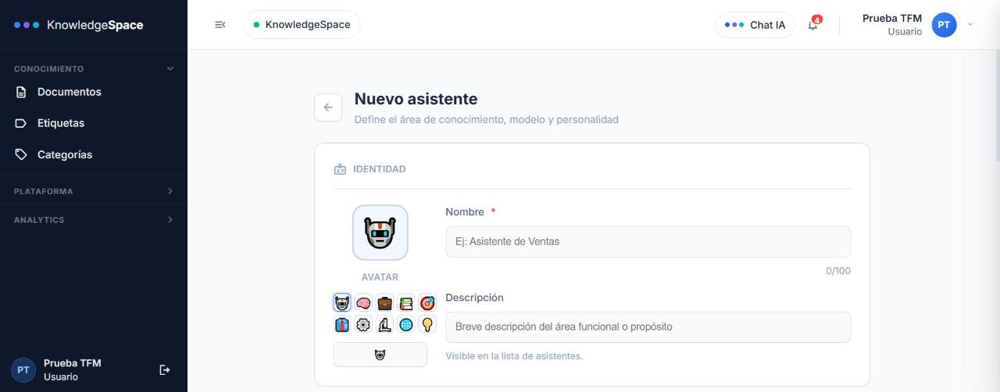

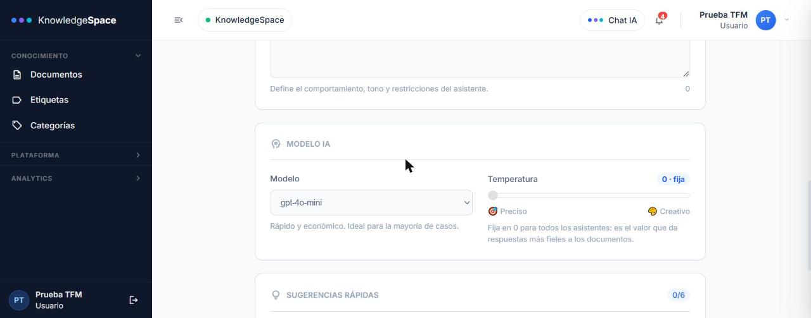

### Paso 2. Subirle documentos

1. Abrir el asistente (botón **Gestionar**) y entrar en la pestaña **Documentos**.
2. Arrastrar los archivos a la zona de carga, o hacer clic para elegirlos.
   Formatos: **PDF, DOCX, TXT y MD**, hasta **10 MB por archivo**. Se puede
   asignar una categoría a toda la carga.
3. Esperar a que cada documento pase a **Completado**. El procesamiento
   (extraer el texto, dividirlo en fragmentos e indexarlo) ocurre en segundo
   plano, y la pantalla se actualiza sola.

Si un documento queda en **fallido**, se puede reintentar desde el mismo
listado. Al terminar llega un aviso a **Notificaciones**.

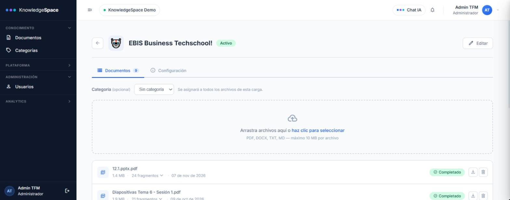

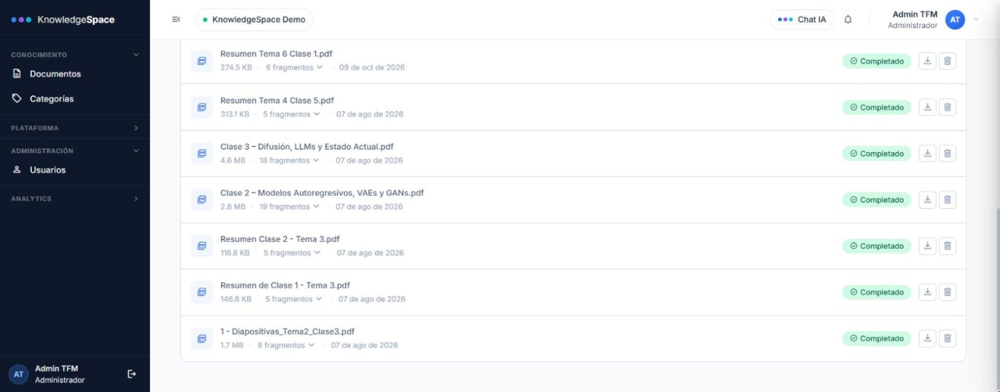

También se pueden subir documentos desde **Documentos → Subir documento**,
eligiendo a qué asistente se asignan.

### Paso 3. Preguntar en el Chat IA

1. Pulsar el botón **Chat IA** de la cabecera. El chat se abre en un panel
   lateral; no tiene entrada propia en el menú.
2. Si la empresa tiene varios asistentes, elegir uno en la fila
   **Asistente**, en la parte superior del panel.
3. Escribir la pregunta y enviarla.

Cada respuesta muestra sus **fuentes**: los documentos consultados, con su
puntuación de relevancia. Desde ahí se puede ver el fragmento exacto que usó
el asistente y descargar el documento original. La respuesta se puede copiar,
y dentro de la conversación se puede buscar texto. Debajo de cada respuesta se
muestra también lo que costó.

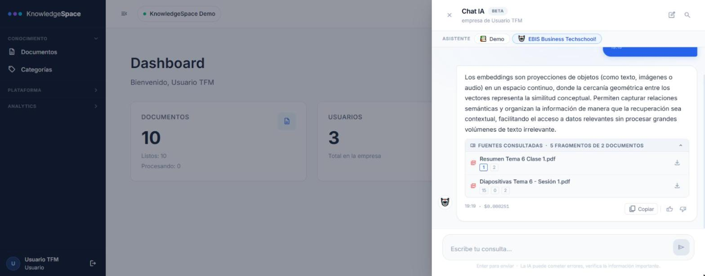

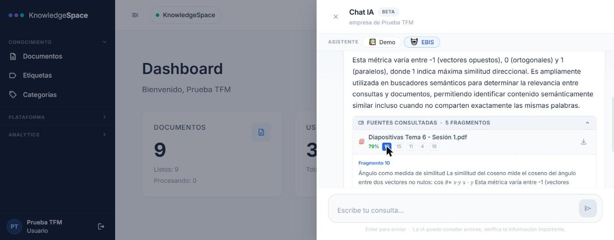

**Si el asistente responde «No encontré información sobre este tema en los
documentos de la empresa»,** está funcionando como debe: no inventa. Significa
que ningún fragmento de sus documentos era lo bastante relevante. Lo habitual
es que el documento que contiene la respuesta no esté subido a **ese**
asistente.

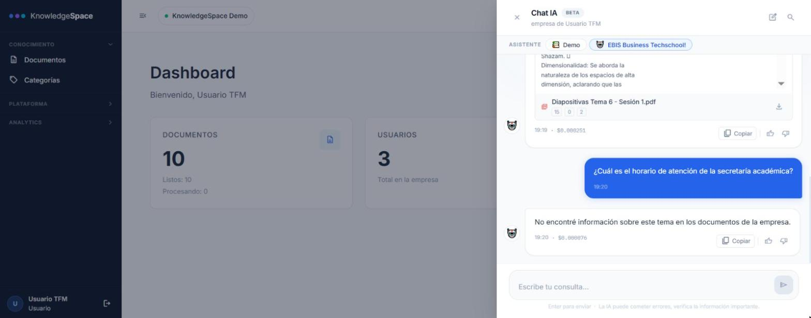

### Paso 4. Calificar la respuesta

Debajo de cada respuesta hay un pulgar arriba y uno abajo. El pulgar arriba se
guarda al momento. El pulgar abajo abre el cuadro **«¿Qué estuvo mal?»**: la
calificación negativa solo se guarda al pulsar **Enviar**. Esa calificación
alimenta **Feedback IA** y **Sin respuesta**: es como la empresa descubre qué le
falta a su documentación.

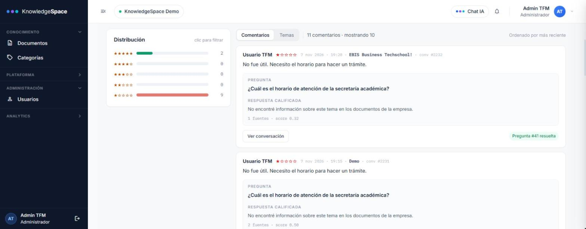

---

## 4. Gestionar los documentos

En **Documentos** están todos los documentos de la empresa:

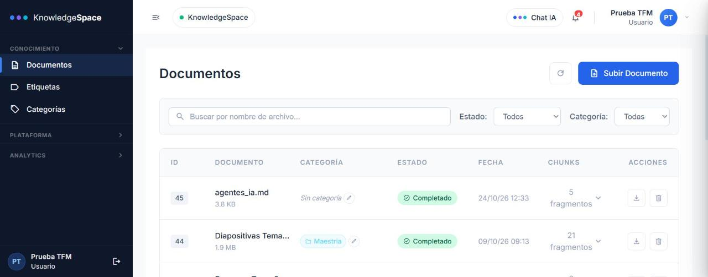

- Buscar por nombre y filtrar por estado (pendiente, procesando, completado,
  fallido) o por categoría.
- Cambiar la categoría directamente en el listado.
- Descargar el original: cada descarga genera un enlace temporal nuevo.
- Reintentar los fallidos y eliminar con confirmación.

**Etiquetas** y **Categorías** son catálogos para organizar los documentos:
nombre y color, y en las categorías también descripción, icono y orden.

---

## 5. Revisar la calidad de las respuestas

### Feedback IA

Resume cómo califican los usuarios las respuestas:

- Elegir el **período** (este mes, 90 días o 12 meses) y, si se quiere, un
  asistente concreto.
- Las tarjetas superiores muestran la satisfacción, el número de respuestas
  negativas y cuántas están en seguimiento.
- La lista de comentarios se puede ver uno a uno o agrupada por **temas**.
- Desde una respuesta negativa: **Ver conversación** o **Enviar a preguntas sin
  respuesta**.
- **Exportar comentarios** descarga un CSV.

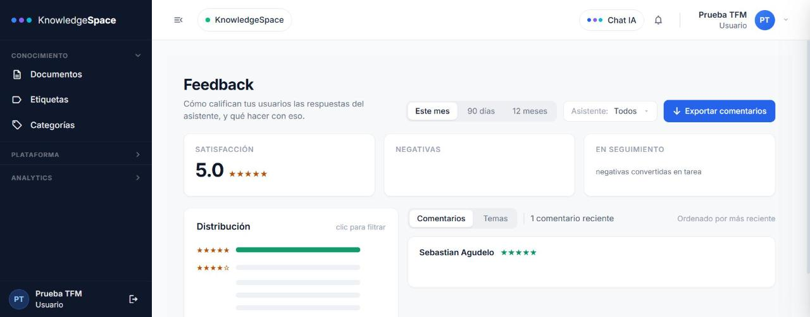

### Sin respuesta (preguntas sin respuesta)

Son las preguntas que el asistente no supo responder bien, convertidas desde el
feedback. Cada una muestra **cómo se preguntó** y **lo mejor que encontró el
índice**. Si ningún fragmento superó el umbral, la pantalla avisa de que falta
el documento.

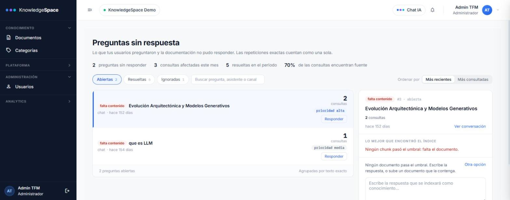

La lista se ordena por **Más recientes** (opción por defecto) o por **Más
consultadas**.

Para resolver una pregunta hay tres opciones:

| Opción | Cuándo usarla |
|---|---|
| **Vincular documento** | El documento ya está subido; se elige entre los candidatos que propone el sistema y se vuelve a indexar |
| **Escribir respuesta** | La respuesta no está en ningún documento; se escribe directamente y se indexa |
| **Ignorar** | No merece resolverse; hay que elegir el motivo: fuera de alcance, puntual o duplicada |

Si la respuesta debería estar en un documento que todavía no existe, se sube
desde **Documentos** y después se vincula.

Al resolverla, el sistema **verifica** la solución: vuelve a lanzar la pregunta
contra el índice y compara la puntuación de antes y de después.

### Notificaciones

Tu bandeja de avisos sobre tus documentos: cuándo terminaron de procesarse,
si fallaron o si los borró otra persona. Cada usuario tiene la suya. Se
filtran por tipo, se marcan como leídas al abrirlas y cada una lleva a lo que
la originó. Las preguntas sin respuesta no generan avisos: lo pendiente se ve
en su propia pantalla.

Para limpiar la bandeja, como en el correo:

- La **papelera** al final de cada aviso lo elimina.
- Para varios, se marcan sus **casillas**. La casilla de arriba marca todos, y
  su flecha permite elegir **Todas, Leídas, No leídas o Ninguna**. Con algo
  marcado aparecen **Marcar como leídas** y **Eliminar** (pide confirmación si
  son varios).

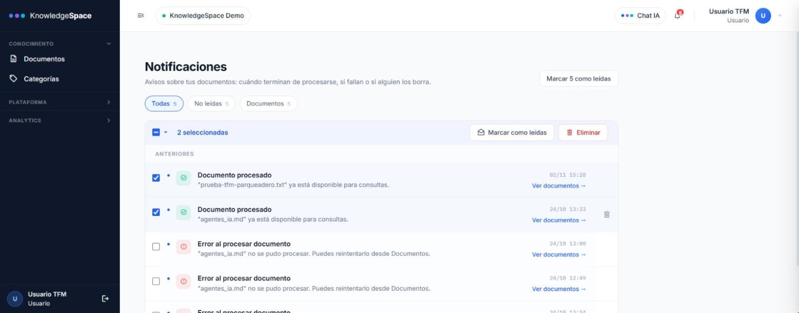

### Dashboard

Tres cifras de la empresa: documentos (totales, completados y en proceso),
usuarios y mensajes. Una empresa sin documentos ve una guía de primeros pasos.

---

## 6. Administración (solo administradores)

- **Usuarios:** crear cuentas (quedan asociadas a la empresa del
  administrador), asignar el rol, activar o desactivar y **restablecer la
  contraseña** de otro usuario.
- **Empresas:** alta y edición de las empresas, con su plan y sus límites de
  usuarios, documentos y mensajes al mes.

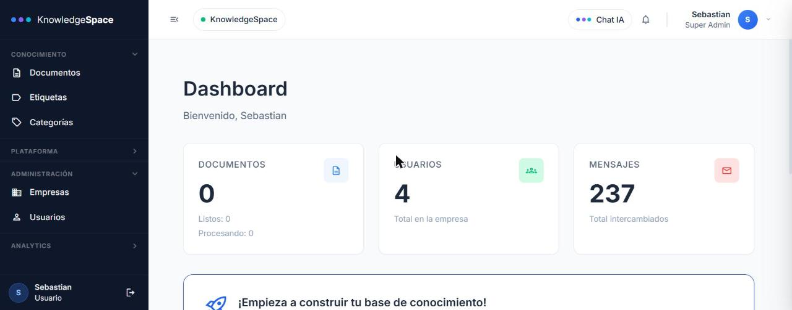

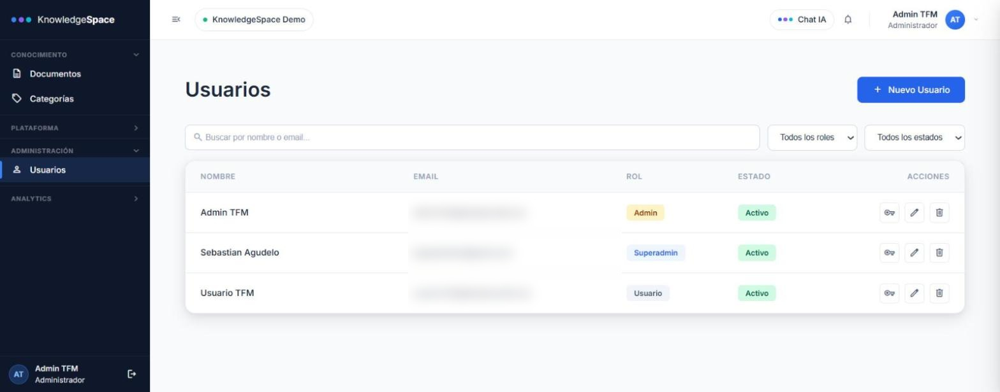

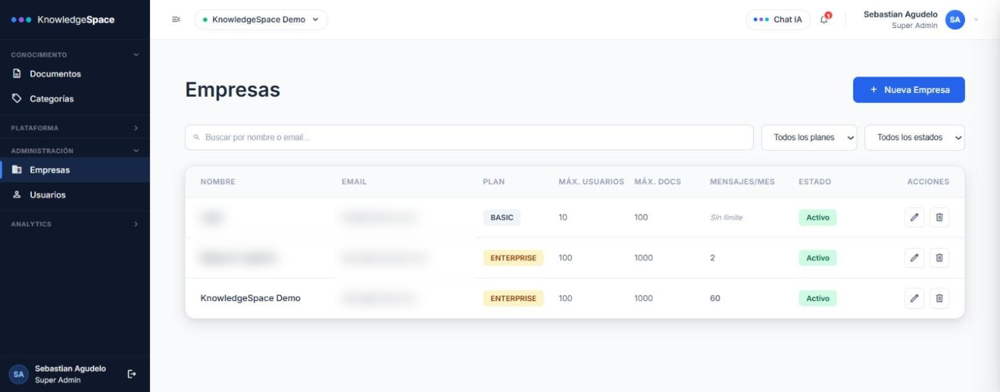

---

## 7. Lo que la aplicación no hace

- **Registro público** y **cambio de la propia contraseña**: no existen; las
  cuentas y los restablecimientos los gestiona un administrador.
- **Respuestas en streaming**: la respuesta del chat llega completa, no palabra
  por palabra.
- **Permisos finos**: ver la limitación de la sección 1.
- **Corregir premisas falsas**: si la pregunta da por cierto algo falso, el
  asistente puede abstenerse o, en algún caso, aceptar la premisa (ver la
  evaluación en el capítulo 5 de la memoria). Conviene formular las preguntas
  de forma neutra.

---

## 8. Problemas frecuentes

| Problema | Causa probable | Qué hacer |
|---|---|---|
| «Email o contraseña incorrectos» | Credenciales mal escritas o cuenta desactivada | Pedir a un administrador que la revise o restablezca la contraseña |
| El documento se queda en **fallido** | El archivo no se pudo leer o falló el indexado | **Reintentar**; si persiste, comprobar que el archivo se abre bien y que contiene texto |
| «No encontré información…» con un tema que sí está documentado | El documento no está asignado a ese asistente, o sigue procesándose | Revisar la pestaña **Documentos** del asistente |
| La sesión se cierra sola | El token de acceso caducó | Volver a iniciar sesión |
