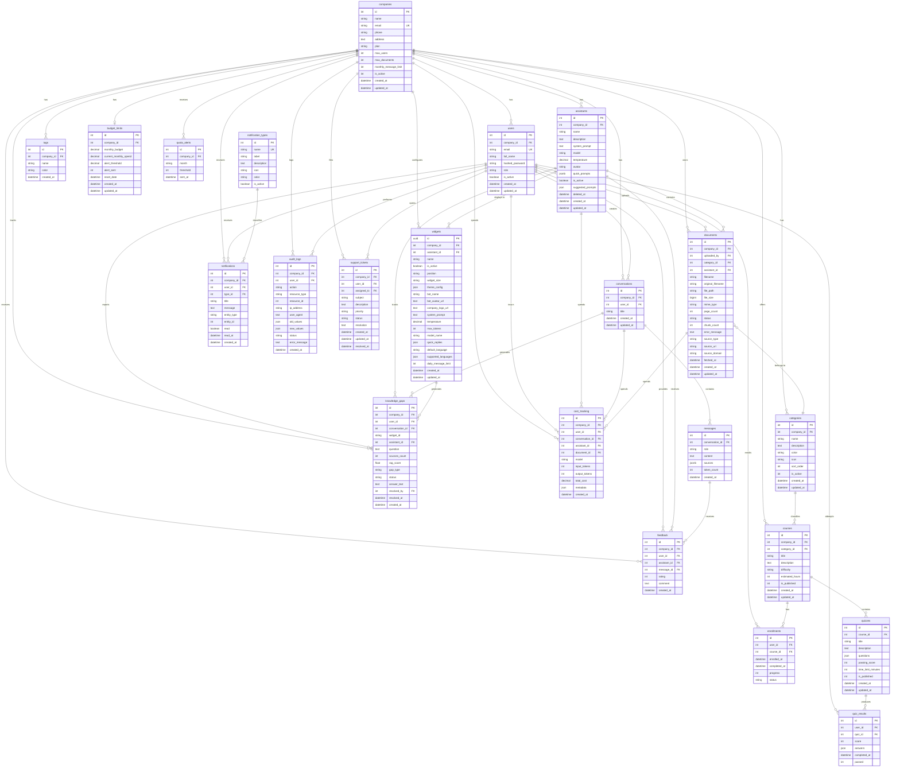

# Modelo de Datos - KnowSpace Backend

## Versión
- **Fecha**: 13 de Agosto de 2026
- **Versión**: 12.1
- **Estado**: Verificado contra el esquema real de Supabase (introspección directa vía `DATABASE_URL`). Incluye tablas sin modelo ORM/endpoint todavía — ver nota en cada una.
- **Cambios v12.1**: se agregó `assistants.quick_prompts` (columna real usada por el código, ausente en v12.0) y se marcó `assistants.suggested_prompts` como columna huérfana — ver sección 2.8.

---

## 0. Propósito de Cada Tabla

| Tabla | Propósito | Descripción |
|-------|-----------|-------------|
| **companies** | Multi-tenancy | Almacena las empresas clientes (tenants). Cada empresa es un tenant independiente con sus propios usuarios, documentos y configuraciones. |
| **users** | Gestión de usuarios | Usuarios por empresa con roles (user, admin, superadmin) para control de acceso. |
| **categories** | Organización de contenido | Categorías para documentos con nombre, descripción, color e icono para UI. Incluye orden de visualización y estado activo. |
| **documents** | Gestión de contenido | Metadatos de documentos subidos. Incluye `assistant_id` para multi-tenancy por asistente, estado de procesamiento, chunk count y mensajes de error. |
| **conversations** | Historial de chat | Conversaciones de chat entre usuarios y la IA. Cada conversación agrupa múltiples mensajes. |
| **messages** | Mensajes individuales | Cada mensaje de una conversación. Incluye rol (user/assistant), contenido, fuentes citadas (JSON) y conteo de tokens. |
| **tags** | Clasificación flexible | Etiquetas para clasificar documentos de forma no jerárquica, con nombre y color para UI. |
| **assistants** | Asistentes de conocimiento | Asistentes especializados con system prompt, modelo, temperatura, avatar y soft-delete. Agrupan documentos y widgets. |
| **widgets** | Canales de despliegue | Configuraciones de widgets de chat con estética (colores, fuentes), identidad del bot, sugerencias rápidas, idiomas y límites de uso. PK en UUID. |
| **feedback** | Calificación de respuestas | Permite calificar respuestas de la IA (1-5 estrellas) con comentario. Vinculado a assistant y message. |
| **knowledge_gaps** | Vacíos de conocimiento | Preguntas que el sistema no pudo responder. Detecta hard/soft gaps, incluye estado (open/resolved/ignored), rag_score y métricas de resolución. |
| **notification_types** | Catálogo de tipos | Catálogo administrable de tipos de notificación con etiqueta, icono y color para UI. |
| **notifications** | Notificaciones | Notificaciones dirigidas a usuarios o a todos los admins de una empresa. Vinculadas a un tipo del catálogo y a una entidad relacionada opcional. |
| **budget_limits** | Presupuesto de IA | Límite de gasto mensual por empresa, con umbral de alerta y gasto acumulado. Tabla ya creada; feature en backlog (`BACKLOG_BACKEND.md`), **sin modelo ORM ni endpoint** todavía. |
| **cost_tracking** | Costo de IA | Registro de costo por request de IA (tokens de entrada/salida, modelo, costo total), enlazable a conversación, asistente y documento. Tabla ya creada; feature en backlog, **sin modelo ORM ni endpoint** todavía. |
| **quota_alerts** | Alertas de cuota | Registro de alertas de cuota mensual ya enviadas por empresa/mes/umbral (evita reenviar la misma alerta). **Sin modelo ORM ni endpoint**, no referenciada en ningún backlog — origen no confirmado. |
| **audit_logs** | Auditoría | Bitácora de acciones (usuario, acción, recurso, IP, user agent, valores antes/después). **Sin modelo ORM ni endpoint**, no referenciada en ningún backlog — origen no confirmado. |
| **support_tickets** | Soporte | Tickets de soporte por empresa (asunto, prioridad, estado, asignado a un usuario, resolución). **Sin modelo ORM ni endpoint**, no referenciada en ningún backlog — origen no confirmado. |
| **courses** | (Fuera de dominio) | Cursos por empresa con categoría, dificultad y estado de publicación. No tiene relación con el flujo actual de KnowledgeSpace (documentos/asistentes/chat); **sin modelo ORM ni endpoint**. Aparenta ser esquema heredado del proyecto hermano TrainIQ. |
| **quizzes** | (Fuera de dominio) | Cuestionarios asociados a un curso, con preguntas en JSON y nota mínima de aprobación. **Sin modelo ORM ni endpoint** — mismo origen probable que `courses`. |
| **quiz_results** | (Fuera de dominio) | Resultados de un usuario en un quiz (puntaje, respuestas, aprobado/no). **Sin modelo ORM ni endpoint**. |
| **enrollments** | (Fuera de dominio) | Inscripción de un usuario a un curso, con progreso y estado. **Sin modelo ORM ni endpoint**. |

> Las tablas marcadas "Fuera de dominio" (`courses`, `quizzes`, `quiz_results`, `enrollments`) no aparecen en `BACKLOG_BACKEND.md` ni tienen código en `app/db/models/` o `app/routers/v1/`. Antes de construir algo sobre ellas, confirmar si son intencionales o resto de un esquema compartido con TrainIQ que debería limpiarse.

---

## 1. Diagrama ERD



---

## 2. Tablas Detalladas

### 2.1 companies

**Modelo:** `app/db/models/company.py`

```python
class Company(Base):
    __tablename__ = "companies"

    id           = Column(Integer, primary_key=True, index=True)
    name         = Column(String(255), nullable=False)
    email        = Column(String(255), unique=True, nullable=False, index=True)
    phone        = Column(String(50), nullable=True)
    address      = Column(Text, nullable=True)
    plan         = Column(String(20), nullable=False, default="basic")
    max_users    = Column(Integer, nullable=False, default=5)
    max_documents= Column(Integer, nullable=False, default=100)
    monthly_message_limit = Column(Integer, nullable=True)
    is_active    = Column(Integer, nullable=False, default=1)
    created_at   = Column(DateTime(timezone=True), server_default=func.now())
    updated_at   = Column(DateTime(timezone=True), onupdate=func.now())
```

| Campo | Tipo | Notas |
|-------|------|-------|
| `id` | Integer PK | |
| `name` | String(255) | |
| `email` | String(255) UK | Indexado |
| `phone` | String(50) | Nullable |
| `address` | Text | Nullable |
| `plan` | String(20) | `basic` (default) |
| `max_users` | Integer | Default 5 |
| `max_documents` | Integer | Default 100 |
| `monthly_message_limit` | Integer | Nullable — límite mensual de mensajes de IA del plan |
| `is_active` | Integer | 0 = inactiva, 1 = activa |
| `created_at` | DateTime TZ | Auto |
| `updated_at` | DateTime TZ | Auto on update |

---

### 2.2 users

**Modelo:** `app/db/models/user.py`

```python
class User(Base):
    __tablename__ = "users"

    id              = Column(Integer, primary_key=True, index=True)
    company_id      = Column(Integer, ForeignKey("companies.id"), nullable=False, index=True)
    email           = Column(String(255), nullable=False, unique=True, index=True)
    full_name       = Column(String(255), nullable=False)
    hashed_password = Column(String(255), nullable=False)
    role            = Column(String(20), default="user", nullable=False)
    is_active       = Column(Boolean, default=True)
    created_at      = Column(DateTime(timezone=True), server_default=func.now())
    updated_at      = Column(DateTime(timezone=True), onupdate=func.now())
```

| Campo | Tipo | Notas |
|-------|------|-------|
| `id` | Integer PK | |
| `company_id` | Integer FK | → companies, indexado |
| `email` | String(255) UK | Indexado |
| `full_name` | String(255) | |
| `hashed_password` | String(255) | sha256_crypt |
| `role` | String(20) | `user` / `admin` / `superadmin` |
| `is_active` | Boolean | Default True |
| `created_at` | DateTime TZ | Auto |
| `updated_at` | DateTime TZ | Auto on update |

---

### 2.3 categories

**Modelo:** `app/db/models/category.py`

| Campo | Tipo | Notas |
|-------|------|-------|
| `id` | Integer PK | |
| `company_id` | Integer FK | → companies, indexado |
| `name` | String(100) | |
| `description` | Text | Nullable |
| `color` | String(7) | Hex color, ej: `#FF5733` |
| `icon` | String(50) | Nombre de icono para UI |
| `sort_order` | Integer | Default 0 |
| `is_active` | Integer | 0 = inactiva, 1 = activa |
| `created_at` | DateTime TZ | Auto |
| `updated_at` | DateTime TZ | Auto on update |

---

### 2.4 documents

**Modelo:** `app/db/models/document.py`

| Campo | Tipo | Notas |
|-------|------|-------|
| `id` | Integer PK | |
| `company_id` | Integer FK | → companies, **not null** |
| `uploaded_by` | Integer FK | → users, **not null** |
| `category_id` | Integer FK | → categories, nullable |
| `assistant_id` | Integer FK | → assistants SET NULL, nullable |
| `filename` | String(255) | Nombre en sistema (UUID-based) |
| `original_filename` | String(255) | Nombre original del usuario |
| `file_path` | String(500) | Ruta/clave en S3, nullable |
| `file_size` | BigInteger | Bytes, nullable |
| `mime_type` | String(100) | Tipo MIME, nullable |
| `page_count` | Integer | Nullable (solo PDFs) |
| `chunk_count` | Integer | Default 0 |
| `status` | String(20) | `pending` (default) / `processing` / `completed` / `failed` |
| `error_message` | Text | Nullable |
| `source_type` | String(10) | Default `file` — origen del documento (ej. `file` / `url`) |
| `source_url` | String(2048) | Nullable — URL de origen si `source_type = url` |
| `source_domain` | String(255) | Nullable — dominio extraído de `source_url` |
| `fetched_at` | DateTime TZ | Nullable — momento en que se descargó desde `source_url` |
| `created_at` | DateTime TZ | Auto |
| `updated_at` | DateTime TZ | Auto on update |

> `source_type`/`source_url`/`source_domain`/`fetched_at` ya existen en la tabla real pero no hay endpoint que los use todavía (la subida "por URL" no está expuesta en `app/routers/v1/documents.py`) — columnas preparadas para una funcionalidad de importación desde web pendiente.

---

### 2.5 conversations

**Modelo:** `app/db/models/conversation.py`

| Campo | Tipo | Notas |
|-------|------|-------|
| `id` | Integer PK | |
| `company_id` | Integer FK | → companies, indexado |
| `user_id` | Integer FK | → users, indexado |
| `title` | String(255) | Default "Nueva Conversación" |
| `created_at` | DateTime TZ | Auto |
| `updated_at` | DateTime TZ | Auto on update |

---

### 2.6 messages

**Modelo:** `app/db/models/message.py`

| Campo | Tipo | Notas |
|-------|------|-------|
| `id` | Integer PK | |
| `conversation_id` | Integer FK | → conversations, indexado |
| `role` | String(20) | `user` / `assistant` |
| `content` | Text | |
| `sources` | JSONB | Array de metadatos de documentos citados |
| `token_count` | Integer | Nullable, para cost tracking |
| `created_at` | DateTime TZ | Auto |

---

### 2.7 tags

**Modelo:** `app/db/models/tag.py`

| Campo | Tipo | Notas |
|-------|------|-------|
| `id` | Integer PK | |
| `company_id` | Integer FK | → companies, indexado |
| `name` | String(100) | |
| `color` | String(7) | Hex color |
| `created_at` | DateTime TZ | Auto |

---

### 2.8 assistants

**Modelo:** `app/db/models/assistant.py`

| Campo | Tipo | Notas |
|-------|------|-------|
| `id` | Integer PK | |
| `company_id` | Integer FK | → companies CASCADE, indexado |
| `name` | String(100) | |
| `description` | Text | Nullable |
| `system_prompt` | Text | Nullable |
| `model` | String(50) | Default `gpt-4o-mini` |
| `temperature` | Numeric(3,2) | Default 0.7 |
| `avatar` | String(255) | Nullable |
| `quick_prompts` | JSONB | Nullable — sugerencias de prompt rápido para el chat. **Columna activa**: mapeada en `assistant.py`, `schemas/assistant.py`, expuesta por el endpoint y consumida en el frontend (`assistant-form`, `chat-detail`) |
| `is_active` | Boolean | Default True, indexado |
| `suggested_prompts` | JSON | Nullable. **Columna huérfana** — existe en la BD real pero no tiene mapeo en `assistant.py` ni en ningún schema/router/frontend. Mismo tipo de remanente que `document_tags` (ver §3.5); candidata a eliminarse una vez confirmado que no la usa nada externo |
| `created_at` | DateTime TZ | Auto |
| `updated_at` | DateTime TZ | Auto on update |
| `deleted_at` | DateTime TZ | Nullable — soft delete |

---

### 2.9 widgets

**Modelo:** `app/db/models/widget.py`

PK en **UUID** para evitar enumeración en URLs públicas.

| Campo | Tipo | Notas |
|-------|------|-------|
| `id` | UUID PK | Auto-generated |
| `company_id` | Integer FK | → companies, indexado |
| `assistant_id` | Integer FK | → assistants SET NULL, indexado |
| `name` | String(255) | |
| `is_active` | Boolean | Default True |
| `position` | String(20) | `bottom-right` (default) |
| `widget_size` | String(20) | `small` / `medium` / `large` |
| `theme_config` | JSON | Colores, fuentes, mensajes de bienvenida |
| `bot_name` | String(100) | Default "Asistente Virtual" |
| `bot_avatar_url` | Text | Nullable |
| `company_logo_url` | Text | Nullable |
| `system_prompt` | Text | |
| `temperature` | Numeric(3,2) | Default 0.1 |
| `max_tokens` | Integer | Default 1000 |
| `model_name` | String(50) | Default `gpt-4o-mini` |
| `quick_replies` | JSON | Sugerencias rápidas |
| `default_language` | String(5) | Default `es` |
| `supported_languages` | JSON | Default `["es", "en"]` |
| `daily_message_limit` | Integer | Default 100 |
| `created_at` | DateTime TZ | Auto |
| `updated_at` | DateTime TZ | Auto on update |

---

### 2.10 feedback

**Modelo:** `app/db/models/feedback.py`

| Campo | Tipo | Notas |
|-------|------|-------|
| `id` | Integer PK | |
| `company_id` | Integer FK | → companies, indexado |
| `user_id` | Integer FK | → users, indexado |
| `assistant_id` | Integer FK | → assistants, nullable, indexado |
| `message_id` | Integer FK | → messages, nullable, indexado |
| `rating` | Integer | 1–5 estrellas |
| `comment` | Text | Nullable |
| `created_at` | DateTime TZ | Auto |

---

### 2.11 knowledge_gaps

**Modelo:** `app/db/models/knowledge_gap.py`

| Campo | Tipo | Notas |
|-------|------|-------|
| `id` | Integer PK | |
| `company_id` | Integer FK | → companies CASCADE, indexado |
| `user_id` | Integer FK | → users SET NULL, nullable |
| `conversation_id` | Integer FK | → conversations SET NULL, nullable |
| `widget_id` | String(36) | Nullable, indexado |
| `assistant_id` | Integer FK | → assistants SET NULL, nullable, indexado |
| `question` | Text | Pregunta no respondida |
| `sources_count` | Integer | Default 0 |
| `rag_score` | Float | Nullable |
| `gap_type` | String(20) | `hard` (sin fuentes) / `soft` (score bajo) |
| `status` | String(20) | `open` / `resolved` / `ignored`, indexado |
| `answer_text` | Text | Nullable — respuesta al resolver |
| `resolved_by` | Integer FK | → users SET NULL, nullable |
| `resolved_at` | DateTime TZ | Nullable |
| `created_at` | DateTime TZ | Auto, indexado |

---

### 2.12 notification_types

Catálogo administrable de tipos de notificación. Permite agregar nuevos tipos sin modificar código.

**Modelo:** `app/db/models/notification_type.py`

```python
class NotificationType(Base):
    __tablename__ = "notification_types"

    id          = Column(Integer, primary_key=True, index=True)
    name        = Column(String(50), nullable=False, unique=True, index=True)
    label       = Column(String(120), nullable=False)
    description = Column(Text, nullable=True)
    icon        = Column(String(50), nullable=True)
    color       = Column(String(7), nullable=True)
    is_active   = Column(Boolean, nullable=False, default=True)
```

| Campo | Tipo | Notas |
|-------|------|-------|
| `id` | Integer PK | |
| `name` | String(50) UK | Slug interno: `document_ready`, `budget_alert`, etc. |
| `label` | String(120) | Texto visible: `"Documento listo"` |
| `description` | Text | Nullable |
| `icon` | String(50) | Nombre de icono: `"bell"`, `"file-check"` |
| `color` | String(7) | Hex color: `"#3B82F6"` |
| `is_active` | Boolean | Default True — desactivar sin eliminar |

**Filas de seed iniciales** (script: `create_tables.py`):

| name | label | color |
|------|-------|-------|
| `document_uploaded` | Documento subido | `#3B82F6` |
| `document_processed` | Documento procesado | `#10B981` |
| `document_failed` | Error en documento | `#EF4444` |
| `document_deleted` | Documento eliminado | `#6B7280` |
| `budget_warning` | Advertencia de presupuesto | `#F59E0B` |
| `budget_exceeded` | Límite de presupuesto | `#EF4444` |
| `budget_reset` | Presupuesto reiniciado | `#3B82F6` |
| `knowledge_gap_found` | Brecha de conocimiento | `#8B5CF6` |
| `knowledge_gap_resolved` | Brecha resuelta | `#10B981` |
| `user_invited` | Usuario invitado | `#3B82F6` |
| `user_joined` | Usuario registrado | `#10B981` |
| `system_alert` | Alerta del sistema | `#6B7280` |

---

### 2.13 notifications

**Modelo:** `app/db/models/notification.py`

```python
class NotificationEntityType(str, PyEnum):
    DOCUMENT      = "document"
    BUDGET_LIMIT  = "budget_limit"
    KNOWLEDGE_GAP = "knowledge_gap"

class Notification(Base):
    __tablename__ = "notifications"

    id          = Column(Integer, primary_key=True, index=True)
    company_id  = Column(Integer, ForeignKey("companies.id", ondelete="CASCADE"), nullable=False, index=True)
    user_id     = Column(Integer, ForeignKey("users.id", ondelete="CASCADE"), nullable=True, index=True)
    type_id     = Column(Integer, ForeignKey("notification_types.id"), nullable=True, index=True)
    title       = Column(String(120), nullable=False)
    message     = Column(Text, nullable=False)
    entity_type = Column(Enum(NotificationEntityType, values_callable=lambda obj: [e.value for e in obj]), nullable=True)
    entity_id   = Column(Integer, nullable=True)
    read        = Column(Boolean, nullable=False, default=False, index=True)
    read_at     = Column(DateTime(timezone=True), nullable=True)
    created_at  = Column(DateTime(timezone=True), server_default=func.now(), index=True)
```

| Campo | Tipo | Notas |
|-------|------|-------|
| `id` | Integer PK | |
| `company_id` | Integer FK | → companies CASCADE, indexado |
| `user_id` | Integer FK | → users CASCADE, **nullable** — null = todos los admins de la empresa |
| `type_id` | Integer FK | → notification_types, **nullable** en la BD real (el modelo lo declara `nullable=False`, pero la columna física no tiene ese constraint), indexado |
| `title` | String(120) | |
| `message` | Text | |
| `entity_type` | Enum | `document` / `budget_limit` / `knowledge_gap` — nullable. Almacenado como string con `values_callable` |
| `entity_id` | Integer | ID de la entidad relacionada, nullable |
| `read` | Boolean | Default False, indexado |
| `read_at` | DateTime TZ | Nullable |
| `created_at` | DateTime TZ | Auto, indexado |

---

### 2.14 budget_limits

**Sin modelo ORM** — tabla ya creada en Supabase para el módulo "Presupuesto/Uso" descrito en `BACKLOG_BACKEND.md` (pendiente de implementar `app/db/models/budget_limit.py` y su router).

| Campo | Tipo | Notas |
|-------|------|-------|
| `id` | Integer PK | |
| `company_id` | Integer FK | → companies CASCADE, **único** (relación 1:1 con companies) |
| `monthly_budget` | Numeric(10,2) | Límite de gasto mensual, not null |
| `current_monthly_spend` | Numeric(10,2) | Default 0 |
| `alert_threshold` | Numeric(5,2) | Default 80.0 — porcentaje al que se dispara la alerta |
| `alert_sent` | Integer | Default 0 |
| `reset_date` | DateTime TZ | Nullable |
| `created_at` | DateTime TZ | Auto |
| `updated_at` | DateTime TZ | Auto |

---

### 2.15 cost_tracking

**Sin modelo ORM** — tabla ya creada en Supabase para el módulo de tracking de costo de IA descrito en `BACKLOG_BACKEND.md` (pendiente de implementar `app/db/models/cost_tracking.py` y su router).

| Campo | Tipo | Notas |
|-------|------|-------|
| `id` | Integer PK | |
| `company_id` | Integer FK | → companies CASCADE, not null |
| `user_id` | Integer FK | → users SET NULL, nullable |
| `conversation_id` | Integer FK | → conversations SET NULL, nullable |
| `assistant_id` | Integer FK | → assistants SET NULL, nullable |
| `document_id` | Integer FK | → documents SET NULL, nullable |
| `model` | String(50) | Modelo LLM usado, not null |
| `input_tokens` | Integer | not null |
| `output_tokens` | Integer | not null |
| `total_cost` | Numeric(12,6) | not null |
| `metadata` | JSON | Nullable |
| `created_at` | DateTime TZ | Auto, indexado |

---

### 2.16 quota_alerts

**Sin modelo ORM ni endpoint**, y sin mención en `BACKLOG_BACKEND.md` — origen no confirmado. Registra qué alertas de cuota mensual ya se enviaron para no duplicarlas.

| Campo | Tipo | Notas |
|-------|------|-------|
| `id` | Integer PK | |
| `company_id` | Integer FK | → companies CASCADE, not null |
| `month` | String(7) | Formato `YYYY-MM`, not null |
| `threshold` | Integer | Umbral (%) que disparó la alerta, not null |
| `sent_at` | DateTime TZ | Auto, not null |

Constraint único en (`company_id`, `month`, `threshold`).

---

### 2.17 audit_logs

**Sin modelo ORM ni endpoint**, y sin mención en `BACKLOG_BACKEND.md` — origen no confirmado. Bitácora genérica de acciones de usuario.

| Campo | Tipo | Notas |
|-------|------|-------|
| `id` | Integer PK | |
| `company_id` | Integer FK | → companies CASCADE, not null |
| `user_id` | Integer FK | → users SET NULL, nullable |
| `action` | String(100) | not null |
| `resource_type` | String(50) | Nullable |
| `resource_id` | Integer | Nullable |
| `ip_address` | String(45) | Nullable |
| `user_agent` | Text | Nullable |
| `old_values` | JSON | Nullable |
| `new_values` | JSON | Nullable |
| `status` | String(20) | Default `success` |
| `error_message` | Text | Nullable |
| `created_at` | DateTime TZ | Auto, indexado |

---

### 2.18 support_tickets

**Sin modelo ORM ni endpoint**, y sin mención en `BACKLOG_BACKEND.md` — origen no confirmado. Mesa de ayuda por empresa.

| Campo | Tipo | Notas |
|-------|------|-------|
| `id` | Integer PK | |
| `company_id` | Integer FK | → companies CASCADE, not null |
| `user_id` | Integer FK | → users CASCADE, not null — quien abre el ticket |
| `assigned_to` | Integer FK | → users SET NULL, nullable |
| `subject` | String(255) | not null |
| `description` | Text | not null |
| `priority` | String(20) | Default `medium` |
| `status` | String(20) | Default `open` |
| `resolution` | Text | Nullable |
| `created_at` | DateTime TZ | Auto |
| `updated_at` | DateTime TZ | Auto |
| `resolved_at` | DateTime TZ | Nullable |

---

### 2.19 courses, 2.20 quizzes, 2.21 quiz_results, 2.22 enrollments — módulo LMS (fuera de dominio)

**Sin modelo ORM ni endpoint**, sin mención en `BACKLOG_BACKEND.md`. Estas cuatro tablas forman un esquema completo de cursos/quizzes que no tiene relación con el flujo actual de KnowledgeSpace (documentos → asistentes → chat/widgets). Todo indica que son remanentes del esquema del proyecto hermano **TrainIQ** aplicados a esta base de datos. Se documentan tal cual existen para dejar constancia, no como funcionalidad activa.

**courses**

| Campo | Tipo | Notas |
|-------|------|-------|
| `id` | Integer PK | |
| `company_id` | Integer FK | → companies CASCADE, not null |
| `category_id` | Integer FK | → categories SET NULL, nullable |
| `title` | String(255) | not null |
| `description` | Text | Nullable |
| `difficulty` | String(20) | Default `intermediate` |
| `estimated_hours` | Integer | Nullable |
| `is_published` | Integer | Default 0 |
| `created_at` / `updated_at` | DateTime TZ | Auto |

**quizzes**

| Campo | Tipo | Notas |
|-------|------|-------|
| `id` | Integer PK | |
| `course_id` | Integer FK | → courses CASCADE, not null |
| `title` | String(255) | not null |
| `description` | Text | Nullable |
| `questions` | JSON | Nullable |
| `passing_score` | Integer | Default 70 |
| `time_limit_minutes` | Integer | Nullable |
| `is_published` | Integer | Default 0 |
| `created_at` / `updated_at` | DateTime TZ | Auto |

**quiz_results**

| Campo | Tipo | Notas |
|-------|------|-------|
| `id` | Integer PK | |
| `user_id` | Integer FK | → users CASCADE, not null |
| `quiz_id` | Integer FK | → quizzes CASCADE, not null |
| `score` | Integer | not null |
| `answers` | JSON | Nullable |
| `completed_at` | DateTime TZ | Auto |
| `passed` | Integer | Default 0 |

**enrollments**

| Campo | Tipo | Notas |
|-------|------|-------|
| `id` | Integer PK | |
| `user_id` | Integer FK | → users CASCADE, not null |
| `course_id` | Integer FK | → courses CASCADE, not null |
| `enrolled_at` | DateTime TZ | Auto |
| `completed_at` | DateTime TZ | Nullable |
| `progress` | Integer | Default 0 |
| `status` | String(20) | Default `in_progress` |

Constraint único en (`user_id`, `course_id`) — un usuario no puede inscribirse dos veces al mismo curso.

---

## 3. Notas de Implementación

### 3.1 Base de Datos
- **ORM**: SQLAlchemy
- **Base class**: `app/db/base.py → Base`
- **Database**: PostgreSQL (Supabase)
- **Timezone**: Todos los campos datetime usan `DateTime(timezone=True)`

### 3.2 Patrones Comunes
- **created_at**: `server_default=func.now()` — generado por la BD
- **updated_at**: `onupdate=func.now()` — actualizado por la BD
- **Soft delete**: `deleted_at` nullable (solo en `assistants`)
- **Foreign Keys**: `CASCADE` cuando el hijo no tiene sentido sin el padre; `SET NULL` cuando es referencia opcional
- **Índices**: campos frecuentemente filtrados tienen `index=True`

### 3.3 Seguridad
- **Passwords**: hasheados con `sha256_crypt` (passlib)
- **Tokens**: JWT firmados con `SECRET_KEY` (HS256)
- **Uploads**: nombre del archivo reemplazado por UUID en disco para evitar path traversal
- **Widget PK**: UUID para evitar enumeración en URLs públicas

### 3.4 Registro de Mappers
Todos los modelos se importan en `app/db/models/__init__.py` para garantizar que SQLAlchemy registre todos los mappers antes de resolver relaciones al arrancar.

### 3.5 Tablas sin modelo ORM (introspección directa vs. `app/db/models/`)

Al comparar el esquema real de Supabase contra `app/db/models/`, las siguientes tablas **existen en la base de datos pero no tienen clase SQLAlchemy ni router**: `budget_limits`, `cost_tracking`, `quota_alerts`, `audit_logs`, `support_tickets`, `courses`, `quizzes`, `quiz_results`, `enrollments`. Detalle de cada una en las secciones 2.14–2.22. `budget_limits` y `cost_tracking` corresponden a features ya definidas en `BACKLOG_BACKEND.md`; el resto no está referenciado en ningún backlog.

> `document_tags` (relación N:N documents↔tags) existía en Supabase pero **se eliminó el 2026-08-09**: no tenía modelo ORM, endpoint ni uso en el frontend (confirmado en `KnowledgeSpace_FrontEnd`), y estaba vacía (0 filas) sin dependientes.

> `assistants.suggested_prompts` (JSON) es huérfana desde al menos el 2026-08-09: en ese mismo commit (`07d2861`) se agregó `quick_prompts` (JSONB) al modelo ORM como el campo real de "prompts rápidos", pero `suggested_prompts` ya existía en la tabla real y quedó sin mapeo ORM, sin schema, sin router y sin uso en el frontend — confirmado por introspección directa el 2026-08-13. Mismo perfil que tenía `document_tags` antes de eliminarse; evaluar si conviene dropearla.

También existe `alembic_version` (tabla de control de migraciones de Alembic, sin datos de negocio) — no se documenta como entidad.

### 3.6 Base de datos objetivo
Conexión vía **Supabase Session Pooler** (`aws-*.pooler.supabase.com:6543`, pgbouncer en modo transacción) — configurado en `DATABASE_URL` (`.env`), consumido por `app/core/database.py`.
